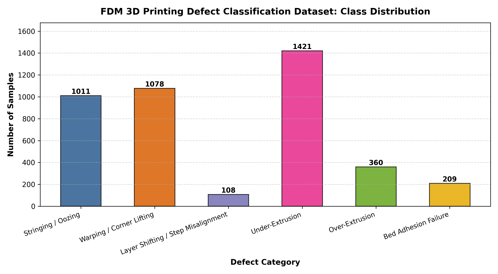
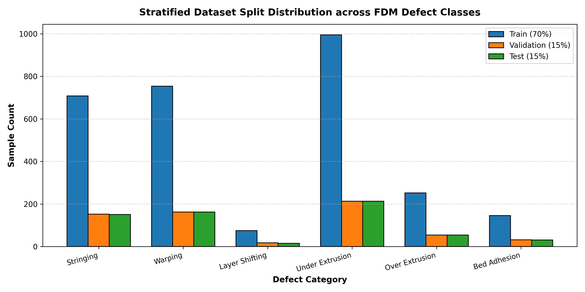
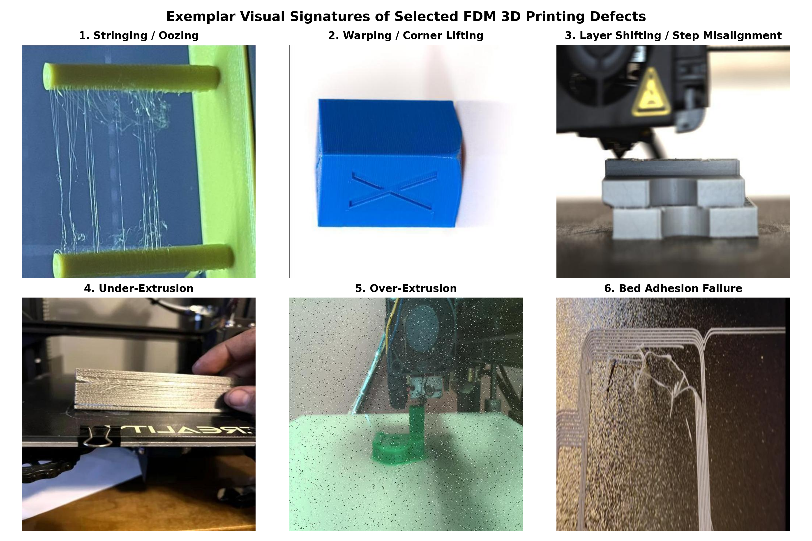

# Data and Experimental Setup

*Generated by `src/report_writer.py` from the pipeline outputs. Do not edit by hand; re-run `python3 run_hena_pipeline.py`.*

## 4. Data

### 4.1 Source
We use the *3D Printing Defect Classification* dataset from Roboflow Universe
(https://universe.roboflow.com/project-jkfnh/3d-printing-defect-classification, CC BY 4.0), version 1,
exported on July 17, 2025. The export contains 22,048 images with image-level class labels in folder format.
Roboflow auto-oriented every image and resized it to 640 x 640 pixels (stretch); no augmentation was applied in the export.

### 4.2 Class selection
Following the proposal, we keep six defect classes and exclude all other categories, including "No Defect".

| Class | Roboflow folder | Images extracted |
|---|---|---|
| Stringing / Oozing | Stringing | 1333 |
| Warping / Corner Lifting | Warping | 1514 |
| Layer Shifting / Step Misalignment | Layer Shifting | 899 |
| Under-Extrusion | Under Extrusion | 1544 |
| Over-Extrusion | over extrusion | 501 |
| Bed Adhesion Failure | bed adhesion | 341 |
| **Total** |  | **6132** |

### 4.3 Cleaning
- Every image was opened and verified; corrupt files are dropped. MD5 hashes remove exact duplicates.
- Roboflow renames files to `<original>_jpg.rf.<hash>.jpg`. Grouping by the original name shows that the
  6132 extracted images come from 5840 distinct source photos.
- 1 source photo(s) carried two different defect labels and were removed.
- *Pending:* Agya (manufacturing) is reviewing 50 random training images per class (`data/rules/class_audit.csv`); corrections are applied automatically on the next pipeline run.

### 4.4 Near-duplicate scenes
Many images are frames of the same video or re-uploads of one photo with rotation, noise or colour changes, under
different file names. Grouping by file name alone leaves them in different splits: with that split, 18% of test images
had a training image with a near-identical perceptual hash, and the median test image had a training neighbour at cosine
similarity 0.92 (ImageNet ResNet-50 features). Models trained on that split scored 94-96% test accuracy, which overstated
how well they generalise to new prints (those runs are kept in `archive/leaky_split_models/`).

We therefore group images into *scenes* (`src/scene_groups.py`): each image is embedded with an ImageNet-pretrained
ResNet-50 (not the fine-tuned classifier, so grouping follows content rather than class), and within each class two images
are linked when their cosine similarity is at least 0.75 or they share a Roboflow source photo. The
threshold was chosen by inspecting image pairs: almost every pair above it showed the same printed object. Linked images form
one scene.

| Class | Images | Scenes | Largest scene |
|---|---|---|---|
| Stringing / Oozing | 1333 | 323 | 352 (26%) |
| Warping / Corner Lifting | 1514 | 173 | 445 (29%) |
| Layer Shifting / Step Misalignment | 899 | 24 | 433 (48%) |
| Under-Extrusion | 1544 | 343 | 127 (8%) |
| Over-Extrusion | 501 | 195 | 171 (34%) |
| Bed Adhesion Failure | 341 | 88 | 88 (26%) |

Because frames of one scene are not independent samples, at most 30 images per scene are kept
(chosen at random with the fixed seed); 1945 near-duplicate frames are removed. This matters most
for layer shifting, whose 899 images come from only 24 scenes: its validation and test
sets contain few scenes, so its per-class results are less certain than the other classes'. After the split, the median test image's most similar training image has cosine similarity 0.592, and 0.3% of test images have a training image at 0.9 or above (these are matches across classes, which scene grouping does not cover).

### 4.5 Train / validation / test split
Roboflow's own split is not used: 103 source photos appear in more than one
of its train/valid/test folders. We make a stratified 70/15/15 split per class with seed 42, assigning whole
scenes to one split (largest scenes first, each to the split furthest below its target size), so no scene appears in two splits.
Both models (RQ1, RQ2) use exactly this split, recorded in `data/manifests/data_split_manifest.csv`.

| Class | Train | Val | Test | Total |
|---|---|---|---|---|
| Stringing / Oozing | 708 | 152 | 151 | 1011 |
| Warping / Corner Lifting | 754 | 162 | 162 | 1078 |
| Layer Shifting / Step Misalignment | 75 | 18 | 15 | 108 |
| Under-Extrusion | 995 | 213 | 213 | 1421 |
| Over-Extrusion | 252 | 54 | 54 | 360 |
| Bed Adhesion Failure | 146 | 32 | 31 | 209 |
| **Total** | 2930 | 631 | 626 | 4187 |

### 4.6 Class imbalance
The classes are imbalanced: Under-Extrusion has 1421 images and Layer Shifting / Step Misalignment has
108 (13.2x fewer). The training loss uses inverse-frequency class weights
w_c = N / (K * N_c), computed on the training split:

| Class | Weight |
|---|---|
| Stringing / Oozing | 0.6897 |
| Warping / Corner Lifting | 0.6477 |
| Layer Shifting / Step Misalignment | 6.5111 |
| Under-Extrusion | 0.4908 |
| Over-Extrusion | 1.9378 |
| Bed Adhesion Failure | 3.3447 |

Because of the imbalance, macro-averaged precision, recall and F1 (RQ1) are reported alongside accuracy.

### 4.7 Preprocessing and augmentation
All images are resized to 224 x 224 and normalized with ImageNet channel statistics
(mean 0.485/0.456/0.406, std 0.229/0.224/0.225), matching the ImageNet-pretrained MobileNet and ResNet backbones.
Training images only are augmented with random horizontal and vertical flips, rotation of up to +/-15 degrees,
and brightness, contrast and saturation jitter, following the hue/saturation augmentation of De La Rosa et al. (2024).
Validation and test images are only resized and normalized.

## 5. Experimental Setup

### 5.1 Classification (RQ1, RQ2)
MobileNet and ResNet are fine-tuned on the split above with identical settings (optimizer, learning rate, epochs,
early stopping, augmentation, class weights). Training details and results are in the Methods and Results sections.

### 5.2 Correction framework evaluation (RQ3)
**Independence.** The rule table (`data/rules/rule_table.json`) is written by Agya (manufacturing). The reference
recommendations (`docs/INDEPENDENT_REFERENCE_TABLE.md`) were compiled separately by Hena from a different set of
sources (Prusa, Simplify3D, All3DP, Gibson et al.), and Agya does not see them before submitting the rule table.

**Scenario evaluation.** 18 predefined scenarios (`docs/PREDEFINED_SCENARIOS.md`) cover the six defects at three
severity levels on PLA, PETG and ABS. Each is passed to the rule engine as a correct, confident classification, and its
primary action is compared with the reference. Metrics: primary action agreement (same parameter and direction),
primary parameter agreement, any-action overlap between the two action lists, and Cohen's kappa on the primary action.

**End-to-end simulation.** Instead of physical printer control, each test image is replayed through the full system:
the classifier's predicted class and confidence go to the rule engine, which abstains when confidence is below 0.65
(the threshold of De La Rosa et al., 2024). Each recommendation is scored against the reference for the image's *true*
class, so classification errors count as wrong recommendations. We report, per model: end-to-end agreement (share of all
test images that received the reference action), agreement when the system recommends, and the abstention rate.

### 5.3 RQ3 results
*Pending.* The rule table (`data/rules/rule_table.json`, Agya) has not been filled in yet. Re-run `python3 run_hena_pipeline.py` once it is.
