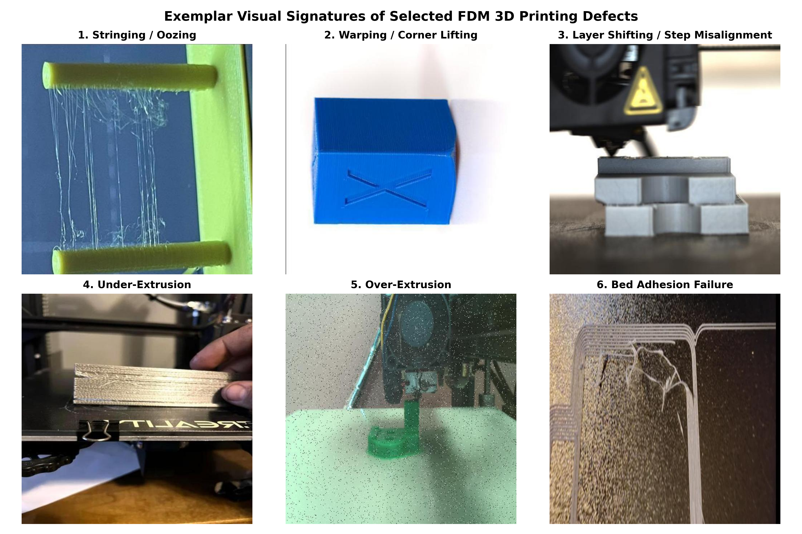
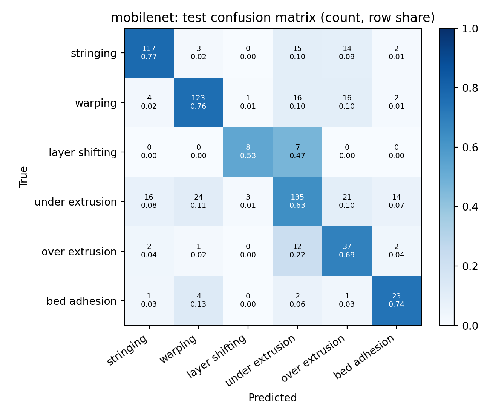
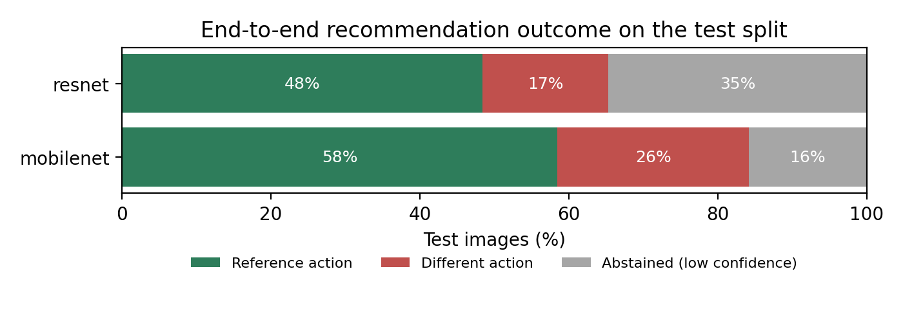
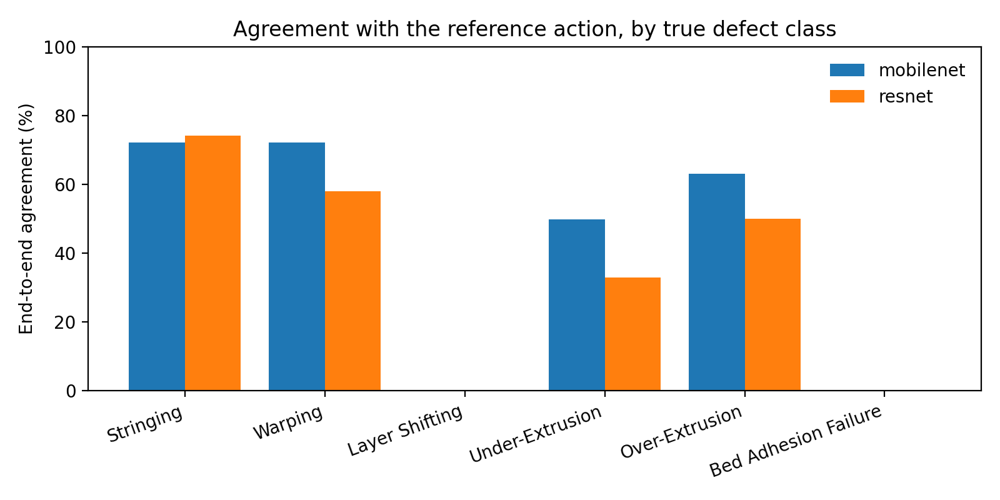

# Deep Learning Based Defect Detection and Rule-Based Correction Framework for FDM 3D Printing

**CSCI 6379 Deep Learning, Final Project Report**
Hena Parween, Harrish, Agya Aboagye-Otchere
November 2026

## Abstract

Fused Deposition Modeling (FDM) printers often produce defects such as stringing, warping and layer shifting, and fixing them usually needs an experienced operator who watches the print and changes settings by hand. We study whether a transfer-learned convolutional neural network (CNN) can recognise six common FDM defects from a single photo, how a small network (MobileNetV2) compares with a large one (ResNet-50), and whether a simple rule table can turn the predicted defect into a sensible corrective action. We use 6,132 images of six classes from a public Roboflow dataset. We found that many images are frames of the same video, which made our first models look much better than they were (94–96% test accuracy). After grouping near-duplicate frames into scenes and splitting by scene, 4,187 images remain. Averaged over three seeds, MobileNetV2 reaches 69.3% test accuracy and 64.3% macro-F1, and ResNet-50 reaches 69.7% and 62.7%. The difference is within the seed-to-seed variation, while MobileNetV2 is 1.5 times faster on a CPU and has 11 times fewer parameters. The rule table agrees with a literature-based reference on the primary action for 4 of 6 defects (Cohen's kappa 0.625), and both tables contain the same actions. When the whole system is simulated on the test set, the recommended primary action matches the reference for 58.5% of images with MobileNetV2 and 48.4% with ResNet-50.

## 1. Introduction

FDM builds a part by melting a thermoplastic filament and depositing it layer by layer. It is cheap and widely used, but a print can fail in many ways. Strings of plastic appear between parts, corners lift off the bed, layers slide sideways, or too much or too little plastic comes out of the nozzle. These defects reduce dimensional accuracy and strength and waste material and time. In practice, an operator has to notice the defect, know what causes it and change the right slicer or printer setting, which takes experience.

Earlier work has shown that deep learning can detect printing problems from camera images and that the printer can be corrected automatically (Jin et al., 2019; Brion and Pattinson, 2022; De La Rosa et al., 2024). Most of these systems need a dedicated camera setup, large self-collected datasets and direct control of the printer. Our project looks at a simpler and more accessible version of the same idea: classify the defect from one image with a pretrained CNN, then look up a corrective action in an interpretable rule table, without controlling a printer.

We answer three research questions:

- **RQ1.** How accurately can a transfer-learned CNN classify six common FDM defect types from images?
- **RQ2.** How does MobileNet compare with ResNet when both are trained on the same data with the same settings?
- **RQ3.** How well does a rule-based correction framework match the six defects to appropriate corrective actions, compared with a reference prepared from the literature?

## 2. Background: the six defects

**Stringing (oozing).** Thin strands of plastic between separate parts of a print. While the nozzle travels without printing, pressure in the hot end pushes molten plastic out. It gets worse at high nozzle temperature, with short retraction and with slow travel moves.

**Warping.** Corners or edges of the part lift from the bed. Newly deposited layers are hot and shrink as they cool, while the first layer is held on the bed; the difference in shrinkage creates stress that pulls the corners up. Materials with high shrinkage such as ABS warp the most. A warmer bed, a brim and an enclosure reduce it.

**Layer shifting.** Layers are offset from each other along X or Y, so the part looks stepped. The cause is mechanical: a loose belt or pulley slips, or a stepper motor skips steps when the head moves too fast or hits a curled-up part of the print.

**Under-extrusion.** Less plastic is deposited than the toolpath needs, which leaves gaps between lines, thin walls and weak infill. Common causes are a partial clog, a flow multiplier that is too low, a nozzle that is too cold for the speed, or a slipping extruder.

**Over-extrusion.** More plastic is deposited than needed, which gives blobs, rough walls and parts that are too large. Typical causes are a flow multiplier or extruder steps setting that is too high, or filament that is thicker than the slicer assumes.

**Bed adhesion failure.** The first layer does not stick, so the print comes loose or never forms a solid base. Usually the nozzle is too far from the bed (Z offset), the bed is not level, or the surface is dirty.

Several of these defects look alike in a photo. Under- and over-extrusion both change how the extruded lines look, and warping and bed adhesion failure both show a part separating from the bed. We expected these pairs to be the hardest for the classifier.

## 3. Related work

Jin et al. (2019) fine-tuned a pretrained ResNet-50 to classify printing as good, under-extruded or over-extruded from images of the nozzle area, with over 98% accuracy, and used the prediction to adjust the flow rate during printing. Their work showed that transfer learning works for this task and that the predicted class can drive a correction.

Brion, Shen and Pattinson (2022) detected warping with YOLOv3 (best validation mAP 88.72%) and combined the detector with expert heuristics to adjust printing conditions, which reduced warping. Brion and Pattinson (2022) trained a multi-head residual attention network on a very large dataset to predict whether flow rate, lateral speed, Z offset and hotend temperature were too low, good or too high (84.3% test accuracy) and corrected them in real time on different printers.

Lu et al. (2023) compared Faster R-CNN, SSD and YOLOv4 for defect detection in robotic printing of continuous fibre composites and found YOLOv4 best (mAP 90.42%), again with closed-loop parameter adjustment. De La Rosa, Armani and Golmohamadi (2024) used VGG-16 with transfer learning to detect stringing, under-extrusion, over-extrusion and weak infill (90.0% test accuracy) and corrected feed rate, nozzle temperature, extrusion amount and fan speed by editing the G-code. They only acted on a class predicted with more than 65% confidence, and we use the same 0.65 threshold.

Compared with these studies, we classify more defect types (six) from a public dataset of mixed photos, compare a lightweight and a large backbone under the same conditions, and keep the correction step as a transparent rule table that is evaluated in simulation instead of on a printer.

## 4. Data

### 4.1 Dataset and class selection

We use the *3D Printing Defect Classification* dataset from Roboflow Universe (version 1, CC BY 4.0). The export has 22,048 images in 19 categories, resized by Roboflow to 640 × 640 pixels. Following the proposal, we keep the six defect classes and use the class folder of each image as its label. This gives 6,132 images (Table 1). We verified every image, removed exact duplicates by MD5 hash and removed one source photo that appeared under two different labels. A manual label audit sheet of 50 training images per class was prepared, but no corrections were made in time, so the labels are used as published.

### 4.2 Near-duplicate frames and data leakage

Our first split grouped images only by their original file name. Models trained on it reached 94–96% test accuracy, which seemed too high. On inspection, many images turned out to be consecutive frames of the same video, or the same photo uploaded again with small changes. Under that split, 18% of test images had a near-identical image in the training set, and the median test image had a training neighbour with cosine similarity 0.92. The models were partly recognising scenes they had already seen.

To fix this, we embedded every image with an ImageNet-pretrained ResNet-50 and, within each class, linked two images when their cosine similarity was at least 0.75 or when they came from the same source photo. Connected images form a *scene*. We chose the threshold by looking at image pairs: almost every pair above it showed the same printed object. Because frames of one scene are not independent samples, we keep at most 30 random images per scene, which removes 1,945 frames. Layer shifting is the most affected class: its 899 images come from only 24 scenes, and only 108 remain. After the fix, the median test image's most similar training image has cosine similarity 0.59.

**Table 1.** Images per class before and after near-duplicate removal, and the final split.

| Class | Extracted | Scenes | Kept | Train | Val | Test |
|---|---|---|---|---|---|---|
| Stringing | 1,333 | 323 | 1,011 | 708 | 152 | 151 |
| Warping | 1,514 | 173 | 1,078 | 754 | 162 | 162 |
| Layer shifting | 899 | 24 | 108 | 75 | 18 | 15 |
| Under-extrusion | 1,544 | 343 | 1,421 | 995 | 213 | 213 |
| Over-extrusion | 501 | 195 | 360 | 252 | 54 | 54 |
| Bed adhesion | 341 | 88 | 209 | 146 | 32 | 31 |
| **Total** | **6,132** | **1,146** | **4,187** | **2,930** | **631** | **626** |

### 4.3 Split, class weights and preprocessing

We did not use Roboflow's own split, because 103 source photos appear in more than one of its folders. Instead we made a 70/15/15 split per class with seed 42 and assigned whole scenes to a split, so no scene appears in two splits. Both models use exactly the same split.

The classes are imbalanced: under-extrusion has 13 times more images than layer shifting. The loss therefore uses inverse-frequency class weights, w_c = N / (K · N_c), computed on the training set (from 0.49 for under-extrusion to 6.51 for layer shifting). For the same reason we report macro-averaged precision, recall and F1 next to accuracy.

Images are resized to 224 × 224 and normalised with ImageNet statistics. Training images are augmented with random horizontal and vertical flips, rotation up to ±15° and brightness, contrast and saturation jitter. Validation and test images are only resized and normalised.

## 5. Experimental setup

### 5.1 Classification (RQ1, RQ2)

Both networks are trained on the split above with identical settings (Section 6) and evaluated once on the 626 test images with accuracy, macro precision, macro recall, macro-F1, per-class recall and inference time per image. Each model is trained with three seeds (1, 2 and 42) under two configurations: a baseline, and a regularised version with stronger weight decay (0.05), a lower fine-tuning learning rate, label smoothing (0.1) and random resized crops. We chose the final configuration by mean validation macro-F1, without looking at the test set.

### 5.2 Correction framework (RQ3)

Two tables are compared. The **rule table** (Section 8) gives, for each defect, a primary corrective action and two secondary actions. The **reference table** gives a primary and a secondary action per defect, compiled from Prusa, Simplify3D, All3DP and Gibson et al. (2021). An action is a printing parameter from a shared vocabulary plus a direction (increase, decrease, enable or check).

The original plan was for the manufacturing team member to write the rule table without seeing the reference. In the end, the rule table was drafted later by the team member who had compiled the reference, from De La Rosa et al. (2024), Jin et al. (2019), Simplify3D and Prusa, without consulting the reference while drafting. The two tables therefore share an author and some sources. RQ3 measures how consistent two literature-based tables are, not agreement between independent experts.

**Scenario evaluation.** 18 predefined scenarios cover the six defects at three severity levels on PLA, PETG and ABS. Each scenario is passed to the rule engine as a correct, confident classification. We report primary action agreement (same parameter and direction), any-action overlap between the two tables, and Cohen's kappa on the primary action.

**End-to-end simulation.** Instead of controlling a printer, we replay every test image through the whole system. The classifier's predicted class and confidence go to the rule engine, which gives no recommendation when the confidence is below 0.65 (De La Rosa et al., 2024). Each recommendation is compared with the reference action for the image's *true* class, so a misclassification counts as a wrong recommendation. We report the share of test images that received the reference action (end-to-end agreement), the agreement among images where the system made a recommendation, and the abstention rate.

## 6. Methods

**Models.** MobileNetV2 (Sandler et al., 2018) is a lightweight network built from inverted residual blocks with depthwise separable convolutions (2.2 M parameters). ResNet-50 (He et al., 2016) is a 50-layer residual network (23.5 M parameters). We use the torchvision ImageNet weights (IMAGENET1K_V1 for MobileNetV2, IMAGENET1K_V2 for ResNet-50) and replace the final classifier with a new fully connected layer with six outputs.

**Training.** Training has two stages. In stage 1 the backbone is frozen and only the new layer is trained for 5 epochs with learning rate 0.001. In stage 2 the whole network is fine-tuned for up to 30 epochs with learning rate 0.0001. Both stages use AdamW (Loshchilov and Hutter, 2019) with weight decay 0.0001, batch size 32 and class-weighted cross-entropy. The learning rate is reduced by a factor of 10 when validation macro-F1 has not improved for 2 epochs, training stops after 6 epochs without improvement, and the checkpoint with the best validation macro-F1 is kept. Training ran on an Apple M4 Pro GPU with PyTorch 2.5.1 and took about 6–7 minutes per model.

**Inference time.** We measure the mean time per image over 100 test images at batch size 1, after 10 warm-up images, on the GPU and on the CPU.

## 7. Results: classification (RQ1, RQ2)

### 7.1 Choice of configuration

The baseline configuration had higher mean validation macro-F1 than the regularised one (53.3% vs. 47.4%), so it is the final configuration. The regularised models were 6–13 points worse on every metric; with this little data, the extra regularisation probably made the models underfit.

### 7.2 Overall performance

**Table 2.** Test results of the final (baseline) configuration, mean ± standard deviation over three seeds.

| Metric | MobileNetV2 | ResNet-50 |
|---|---|---|
| Accuracy | 69.3 ± 2.4% | 69.7 ± 1.8% |
| Macro-F1 | 64.3 ± 2.3% | 62.7 ± 0.9% |
| Validation macro-F1 | 52.4 ± 1.8% | 54.1 ± 0.7% |
| Parameters | 2.2 M | 23.5 M |
| CPU time per image | 13.7 ms | 20.6 ms |

For the seed-42 run, MobileNetV2 reaches 70.8% accuracy, 66.1% macro precision, 68.8% macro recall and 66.5% macro-F1; ResNet-50 reaches 67.9%, 60.1%, 69.3% and 62.3%. On the GPU, MobileNetV2 needs 6.6 ms per image and ResNet-50 8.2 ms. MobileNetV2 trained for 28 epochs (best at epoch 22), while ResNet-50 stopped after 12 (best at epoch 6), which suggests the larger network starts to overfit much earlier on this small training set.

Validation macro-F1 is about 10 points lower than test macro-F1 for both models. With whole scenes assigned to each split, a split contains a limited number of scenes, and the validation scenes are probably harder than the test scenes; layer shifting, for example, has only a few scenes in each split.

### 7.3 Per-class results

**Table 3.** Per-class recall (seed 42) and test images per class.

| Defect | Test images | MobileNetV2 | ResNet-50 |
|---|---|---|---|
| Stringing | 151 | 77.5% | 82.1% |
| Warping | 162 | 75.9% | 69.1% |
| Layer shifting | 15 | 53.3% | 60.0% |
| Under-extrusion | 213 | 63.4% | 55.9% |
| Over-extrusion | 54 | 68.5% | 64.8% |
| Bed adhesion | 31 | 74.2% | 83.9% |

Stringing and warping are recognised best. The most common confusions are between under- and over-extrusion, which both change the look of the extruded lines, and from layer shifting to under-extrusion (7 of 15 layer-shifting test images for MobileNetV2). Over-extrusion has low precision (0.42 for MobileNetV2): 51 stringing, warping and under-extrusion test images are predicted as over-extrusion, against 37 correct over-extrusion predictions. Bed adhesion has high recall but precision of only about 0.5, mostly because under-extrusion images are predicted as bed adhesion (14 images).

### 7.4 Answers to RQ1 and RQ2

**RQ1.** A transfer-learned CNN classifies the six defects with about 70% accuracy and 63–64% macro-F1 on scenes it has not seen. Performance is clearly above chance (16.7%) but far from the 90%+ reported in studies that use a fixed camera and their own printing data. Our own first results show how much of such a gap can come from near-duplicate images.

**RQ2.** The two models are equally accurate within the seed-to-seed spread (macro-F1 gap of 1.6 points, standard deviations of 0.9–2.3 points). MobileNetV2 is 1.5 times faster on a CPU and has 11 times fewer parameters, so it is the better choice for monitoring on low-cost hardware next to a printer.

## 8. The correction rule table

Table 4 shows the rule table. Each rule has a primary action, two secondary actions, a typical size of the change, a physical rationale and citations. The rule engine returns the actions for the predicted defect only when the classifier's confidence is at least 0.65; otherwise it gives no recommendation and leaves the decision to the operator.

**Table 4.** Rule table (`data/rules/rule_table.json`).

| Defect | Primary action | Secondary actions | Sources |
|---|---|---|---|
| Stringing | Increase retraction distance (+0.5–1 mm direct drive, +1–2 mm Bowden) | Decrease nozzle temperature (5–10 °C); increase travel speed (20–50 mm/s) | De La Rosa et al. 2024; Simplify3D; Prusa |
| Warping | Increase bed temperature (5–10 °C) | Enable a brim (5–10 mm); enable an enclosure or draft shield | Simplify3D; Prusa |
| Layer shifting | Check belt tension and pulley set screws | Decrease travel and print speed (20–30%); check motor current, jerk and acceleration | Simplify3D; Prusa |
| Under-extrusion | Increase flow rate (5–10%) | Increase nozzle temperature (5–10 °C); decrease print speed (10–20%) | De La Rosa et al. 2024; Jin et al. 2019; Simplify3D |
| Over-extrusion | Decrease flow rate (5–10%) | Decrease nozzle temperature (5 °C); increase cooling fan speed (10–20%) | De La Rosa et al. 2024; Jin et al. 2019; Simplify3D |
| Bed adhesion | Check bed levelling | Decrease Z offset (0.05–0.1 mm); decrease first-layer speed (to 15–20 mm/s) | Simplify3D; Prusa |

For layer shifting and bed adhesion, the rule table puts a mechanical check first, because a loose belt or an unlevel bed cannot be fixed by changing a slicer setting, and changing settings first can hide the real problem.

## 9. Results: correction framework (RQ3)

### 9.1 Scenario evaluation

**Table 5.** Rule table compared with the reference on the 18 scenarios.

| Metric | Value |
|---|---|
| Primary action agreement (parameter and direction) | 66.7% (4 of 6 defects) |
| Any-action overlap | 100% |
| Cohen's kappa (primary action) | 0.625 |

The rule engine maps by defect class only, so the 18 scenarios reduce to six distinct comparisons and severity or material does not change the outcome. The primary actions agree for stringing, warping, under-extrusion and over-extrusion. They differ for layer shifting (rule: check belt tension; reference: decrease speed) and bed adhesion (rule: check bed levelling; reference: decrease Z offset). In both cases the reference's primary action appears in the rule table as a secondary action, and the rule table's mechanical check appears in the reference's hardware checks, so the two tables differ in priority, not in content. A kappa of 0.625 is usually read as substantial agreement, but with only six comparisons it is a rough estimate.

### 9.2 End-to-end simulation

**Table 6.** End-to-end simulation on the 626 test images (seed-42 models).

| Model | Reference action | Different action | No recommendation (confidence < 0.65) | Agreement when recommending |
|---|---|---|---|---|
| MobileNetV2 | 58.5% | 25.7% | 15.8% | 69.5% |
| ResNet-50 | 48.4% | 16.9% | 34.7% | 74.1% |

With a perfect and always-confident classifier, the end-to-end agreement would be 92.7%: every image of the four classes where the tables agree (580 of 626) would receive the reference action. The measured values are lower because of classification errors and abstentions. MobileNetV2 gives the reference action for more images (58.5% vs. 48.4%) because it is more confident and abstains less often. ResNet-50 abstains on more than a third of the test images, but when it does recommend, its recommendation matches the reference more often (74.1% vs. 69.5%), so its confidence is more informative about whether the prediction is right. Per class, agreement is highest for stringing and warping (72–74%) and zero for layer shifting and bed adhesion, where the primary actions of the two tables differ.

**RQ3.** If the classification is correct, the rule table gives the same primary action as the reference for four of the six defects and covers the reference's actions for all six. In the full system, about 58% of test images (MobileNetV2) receive the reference action, and the remaining errors come mostly from misclassification and from the two defects where the tables order their actions differently.

## 10. Discussion

**Data leakage.** The most important lesson of the project is how easily image datasets collected from videos leak between splits. Our first models scored 94–96%, and the honest score on new scenes is about 70%. Published accuracies on similar public datasets should be read with this in mind, and future work should split by scene or by print, not by image.

**Small classes.** Layer shifting has only 24 scenes. Its test set has 15 images from a few scenes, so its per-class numbers can change a lot with a different split. More data for layer shifting, bed adhesion and over-extrusion would help more than a larger model; the fact that ResNet-50 overfits earlier and does not beat MobileNetV2 points the same way.

**Look-alike defects.** Under- and over-extrusion are confused in both directions, and bed adhesion failures are sometimes predicted as warping. These pairs share visual features, and a single photo of a finished or failed part often does not show the cause. Close-up images of the nozzle area, as used by Jin et al. (2019), or images taken during printing would make these classes easier to separate.

**Model choice and confidence.** In accuracy the two models are tied, so cost decides, and MobileNetV2 wins. The RQ3 simulation adds a second point: how often a model is confident matters for a correction system. ResNet-50's lower confidence makes it abstain more but recommend more reliably. A system that acts on the printer automatically might prefer that behaviour, while a system that only gives advice to an operator benefits from MobileNetV2's higher coverage. Calibrating the confidence or tuning the 0.65 threshold per model would be a useful next step.

**Rule table.** The rule table and the reference mostly agree, and where they differ the difference is about what to try first. A real correction system should probably return an ordered list with mechanical checks for mechanical defects, which is what the rule table does. The main limitation of RQ3 is independence: both tables were prepared by the same team member, partly from the same troubleshooting guides, so the agreement is likely higher than it would be between two independent experts. A review of the rule table by a manufacturing expert and a test on a real printer are needed before the framework is used in practice.

**Other limitations.** We use a single public dataset whose images vary in camera, lighting and printer, and its labels were not audited. Each image has one label, although real prints can show several defects at once. The rule engine ignores severity and material, so it gives the same advice for a slight and a severe defect.

## 11. Conclusion

We built and evaluated a pipeline that classifies six FDM printing defects from a single image and maps the predicted defect to corrective printing actions. After removing near-duplicate video frames, which had inflated our first results to 94–96%, both MobileNetV2 and ResNet-50 reach about 70% accuracy on unseen scenes. Their accuracy is the same within seed variation, and MobileNetV2 is faster and much smaller, so it is the better choice for low-cost monitoring (RQ1, RQ2). The rule table agrees with a literature-based reference on the primary action for four of six defects and contains all of the reference's actions; in a full simulation, about 58% of test images receive the reference action with MobileNetV2 (RQ3). The main next steps are more data for the rare classes, images taken during printing, an independent expert review of the rules and a test of the recommendations on a real printer.

## References

Brion, D. A. J., and Pattinson, S. W. (2022). Generalisable 3D printing error detection and correction via multi-head neural networks. *Nature Communications*, 13, 4654.

Brion, D. A. J., Shen, M., and Pattinson, S. W. (2022). Automated recognition and correction of warp deformation in extrusion additive manufacturing. *Additive Manufacturing*, 56, 102838.

Cohen, J. (1960). A coefficient of agreement for nominal scales. *Educational and Psychological Measurement*, 20(1), 37–46.

De La Rosa, A., Armani, A., and Golmohamadi, M. (2024). Defect detection and closed-loop feedback using machine learning for fused filament fabrication. *Procedia CIRP*, 126, 603–608.

Gibson, I., Rosen, D., Stucker, B., and Khorasani, M. (2021). *Additive Manufacturing Technologies* (3rd ed.). Springer.

He, K., Zhang, X., Ren, S., and Sun, J. (2016). Deep residual learning for image recognition. *Proceedings of the IEEE Conference on Computer Vision and Pattern Recognition (CVPR)*, 770–778.

Jin, Z., Zhang, Z., and Gu, G. X. (2019). Autonomous in-situ correction of fused deposition modeling printers using computer vision and deep learning. *Manufacturing Letters*, 22, 11–15.

Loshchilov, I., and Hutter, F. (2019). Decoupled weight decay regularization. *International Conference on Learning Representations (ICLR)*.

Lu, L., Hou, J., Yuan, S., Yao, X., Li, Y., and Zhu, J. (2023). Deep learning-assisted real-time defect detection and closed-loop adjustment for additive manufacturing of continuous fiber-reinforced polymer composites. *Robotics and Computer-Integrated Manufacturing*, 79, 102431.

Prusa Research. Knowledge Base: print quality troubleshooting. https://help.prusa3d.com

Roboflow Universe. 3D Printing Defect Classification dataset (project-jkfnh), version 1, CC BY 4.0. https://universe.roboflow.com/project-jkfnh/3d-printing-defect-classification

Sandler, M., Howard, A., Zhu, M., Zhmoginov, A., and Chen, L.-C. (2018). MobileNetV2: Inverted residuals and linear bottlenecks. *Proceedings of the IEEE Conference on Computer Vision and Pattern Recognition (CVPR)*, 4510–4520.

Simplify3D. Print Quality Troubleshooting Guide. https://www.simplify3d.com/resources/print-quality-troubleshooting/
