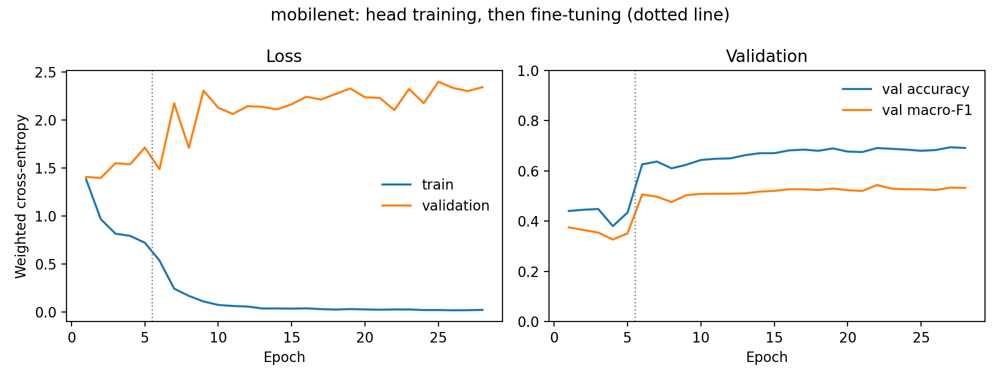
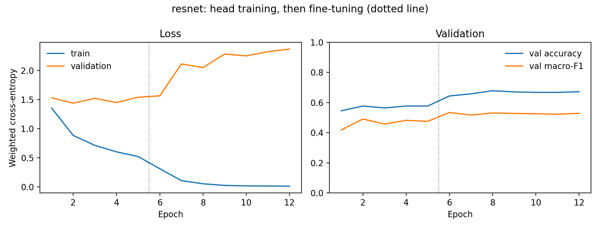
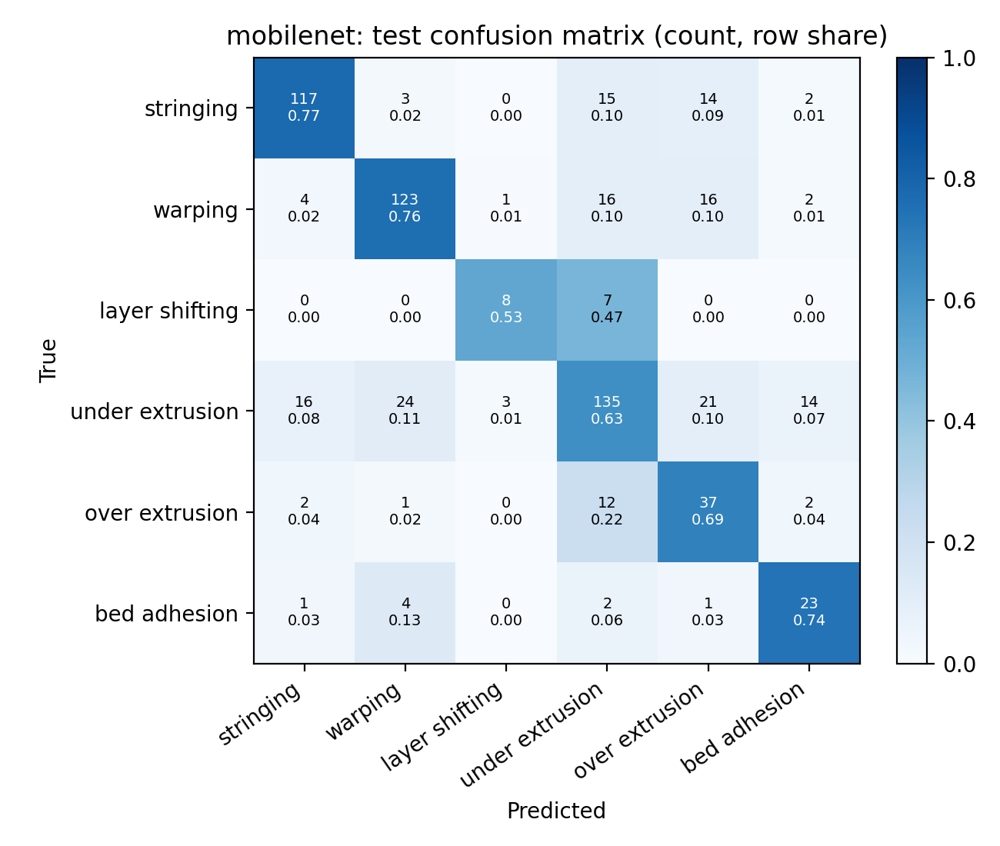
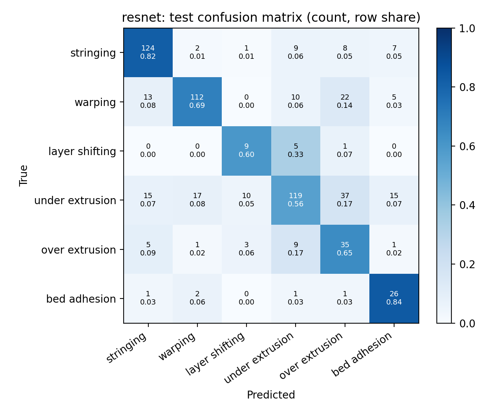

# Methods and Results (RQ1, RQ2)

*Generated by `src/model_report.py` from `reports/model_metrics_<model>.json`. Re-run `src/train.py` to update.*

## 6. Methods

Two ImageNet-pretrained convolutional networks from torchvision 2.5.1 are fine-tuned:
**MobileNetV2** (IMAGENET1K_V1 weights), a lightweight network built from inverted residual blocks with depthwise
separable convolutions, and **ResNet-50** (IMAGENET1K_V2 weights), a 50-layer residual network. In both, the final
ImageNet classifier is replaced by a new fully connected layer with six outputs, one per defect.

Both models use the same data split, preprocessing and augmentation (Section 4), and identical training settings:

| Setting | Value |
|---|---|
| Loss | cross-entropy with inverse-frequency class weights |
| Optimizer | AdamW, weight decay 0.0001 |
| Batch size | 32 |
| Stage 1: frozen backbone, head only | 5 epochs, learning rate 0.001 |
| Stage 2: full fine-tuning | up to 30 epochs, learning rate 0.0001 |
| Learning-rate schedule | ReduceLROnPlateau(factor=0.1, patience=2) on validation macro-F1 |
| Early stopping | no improvement in validation macro-F1 for 6 epochs |
| Model selection | checkpoint with the highest validation macro-F1 |
| Configuration | baseline |
| Label smoothing | 0.0 |
| Random resized crop (scale) | none |
| Seed (Sections 7.1-7.3) | 42 |
| Hardware | Apple M4 Pro, PyTorch 2.5.1 on MPS |

The test split is used once, for the selected checkpoint. Inference time is the mean over 100 test images,
one image at a time (batch size 1) after 10 warm-up images, measured on the MPS GPU and on the CPU.

## 7. Results

### 7.1 Overall test performance (RQ1, RQ2)

| Model | Parameters | Accuracy | Macro precision | Macro recall | Macro F1 | ms/image (MPS) | ms/image (CPU) |
|---|---|---|---|---|---|---|---|
| **MobileNetV2** | 2.2 M | 70.8% | 66.1% | 68.8% | 66.5% | 6.6 | 10.5 |
| **ResNet-50** | 23.5 M | 67.9% | 60.1% | 69.3% | 62.3% | 8.2 | 21.2 |

### 7.2 Per-class recall

| Defect | Test images | MobileNetV2 | ResNet-50 |
|---|---|---|---|
| Stringing / Oozing | 151 | 77.5% | 82.1% |
| Warping / Corner Lifting | 162 | 75.9% | 69.1% |
| Layer Shifting / Step Misalignment | 15 | 53.3% | 60.0% |
| Under-Extrusion | 213 | 63.4% | 55.9% |
| Over-Extrusion | 54 | 68.5% | 64.8% |
| Bed Adhesion Failure | 31 | 74.2% | 83.9% |

### 7.3 Training

| Model | Epochs run | Best epoch | Best validation macro-F1 | Training time (min) |
|---|---|---|---|---|
| MobileNetV2 | 28 | 22 | 54.4% | 6.7 |
| ResNet-50 | 12 | 6 | 53.4% | 6.0 |

### 7.4 Variation across seeds and configurations

*Pending:* run the extra seeds and `python3 -m src.seed_summary`.

### 7.5 Answers

**RQ1.** MobileNetV2 reaches 70.8% test accuracy and 66.5% macro-F1 on the 626 held-out test images; ResNet-50 reaches 67.9% test accuracy and 62.3% macro-F1 on the 626 held-out test images.

**RQ2.** MobileNetV2 has the higher test macro-F1 (66.5% vs. 62.3%, a difference of 4.1 points). On the CPU, MobileNetV2 is 2.0x faster per image (10.5 vs. 21.2 ms) with 11x fewer parameters. Both models were trained and tested on the same split with the same settings, from a single seed, so small differences should not be over-interpreted.
